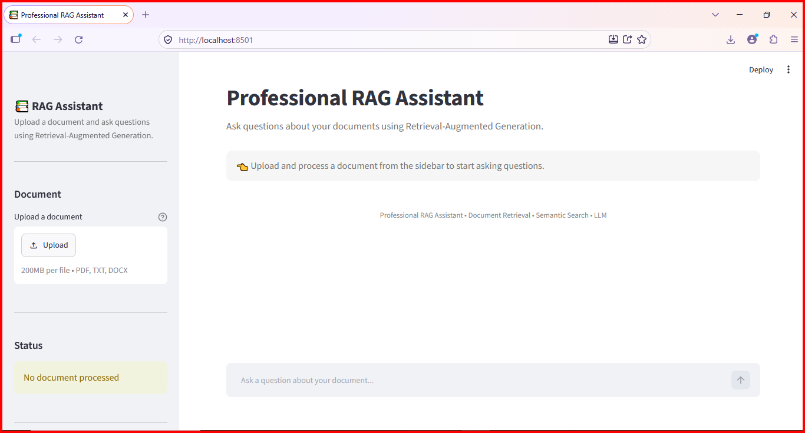
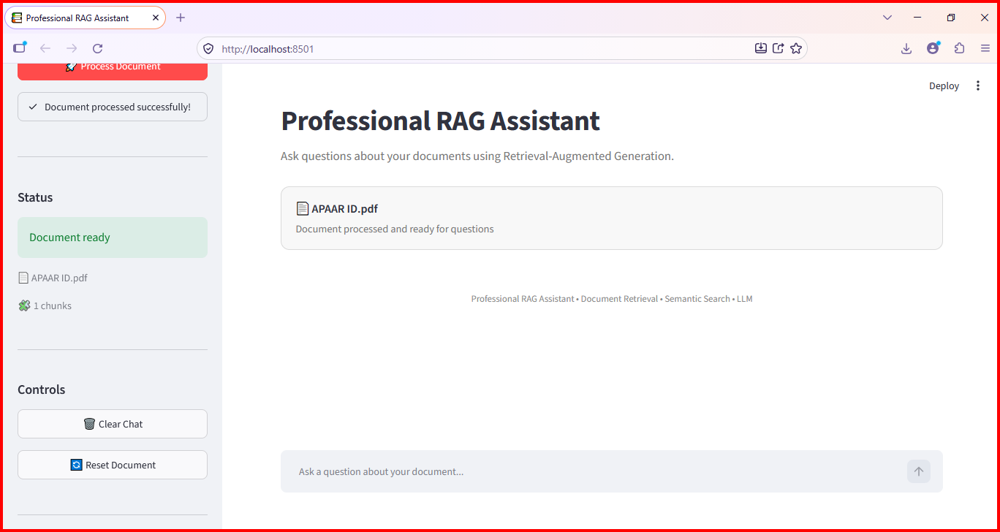
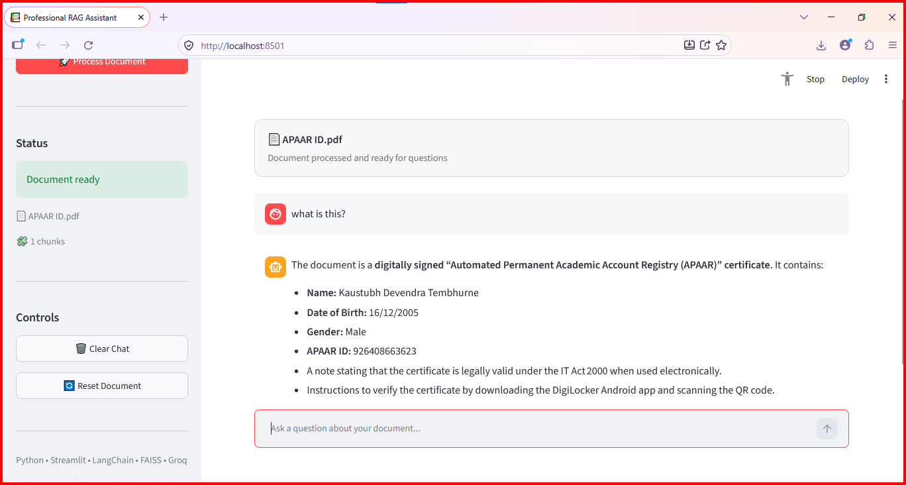

# 🤖 Professional RAG Chatbot

A document-based **Retrieval-Augmented Generation (RAG) chatbot** built with Python, Streamlit, LangChain, FAISS, Sentence Transformers, and Groq.

Upload a **PDF, TXT, or DOCX** file and ask questions about its contents. The application retrieves relevant document chunks using semantic similarity search and uses a Groq-powered large language model (LLM) to generate context-grounded answers.

## 🌐 Live Demo

**[Try Professional RAG Chatbot on Streamlit](https://professional-rag-chatbot-zqtjbwxdba97tjtjcotzvt.streamlit.app/)**

> The live demo depends on the availability of the hosted app, configured secrets, and third-party services.

## 📸 Screenshots

Add your actual screenshots to the repository's `screenshots/` folder, then uncomment or adjust the image paths below to match the exact filenames.







-->

**To show screenshots:** create a folder named `screenshots` in the repository root, upload your screenshots, and replace the example filenames above with the exact filenames. Then remove the HTML comment markers (`<!--` and `-->`) around the image section.

## ✨ Features

- 📄 **Multiple document formats:** Supports PDF, TXT, and DOCX uploads.
- 🧹 **Text cleaning:** Normalizes extracted document text before indexing.
- ✂️ **Text chunking:** Splits long documents into smaller chunks for retrieval.
- 🧠 **Semantic embeddings:** Uses Sentence Transformers to encode document chunks.
- 🔎 **Similarity search:** Retrieves relevant chunks for a user's question.
- 🗂️ **FAISS vector store:** Supports efficient vector similarity search.
- 🤖 **Groq LLM integration:** Generates answers using the configured Groq model.
- 💬 **Interactive chat UI:** Provides a Streamlit interface for document Q&A.
- 📚 **Source information:** Displays available source information alongside answers.
- 🔐 **Environment-based configuration:** Keeps API credentials outside application code.
- 🧪 **Automated tests:** Includes tests for ingestion, retrieval, and RAG components.
- 🧩 **Modular architecture:** Separates ingestion, embeddings, retrieval, and answer generation.

## 🧰 Tech Stack

- **Language:** Python
- **UI:** Streamlit
- **LLM orchestration:** LangChain
- **LLM provider:** Groq
- **Embeddings:** Sentence Transformers
- **Vector search:** FAISS
- **Document processing:** PyPDF, python-docx
- **Configuration:** python-dotenv
- **Testing:** pytest

## 🏗️ Architecture and Request Flow

1. The user uploads a supported document.
2. The application extracts and cleans the document text.
3. The text is split into smaller chunks.
4. Sentence Transformers converts the chunks into vector embeddings.
5. FAISS stores and searches the vectors.
6. The retriever finds chunks relevant to the user's question.
7. The RAG chain combines the question with the retrieved context and sends it to the configured Groq model.
8. The application displays the generated answer and available source information.

The chatbot is designed to ground answers in retrieved document content. Answer quality still depends on document quality, retrieval relevance, and model behavior.

## 📁 Project Structure

```text
professional-rag-chatbot/
├── app.py
├── requirements.txt
├── README.md
├── .gitignore
├── .env.example
│
├── config/
│   ├── __init__.py
│   └── settings.py
│
├── src/
│   ├── __init__.py
│   ├── ingestion/
│   │   ├── __init__.py
│   │   ├── document_loader.py
│   │   ├── text_cleaner.py
│   │   └── chunker.py
│   │
│   ├── embeddings/
│   │   ├── __init__.py
│   │   └── embedding_model.py
│   │
│   ├── retrieval/
│   │   ├── __init__.py
│   │   ├── vector_store.py
│   │   └── retriever.py
│   │
│   ├── chatbot/
│   │   ├── __init__.py
│   │   ├── prompts.py
│   │   ├── rag_chain.py
│   │   └── response_handler.py
│   │
│   └── utils/
│       ├── __init__.py
│       ├── logger.py
│       └── validators.py
│
├── data/
│   ├── documents/
│   └── vectorstore/
│
└── test/
    ├── test_ingestion.py
    ├── test_retrieval.py
    └── test_rag.py
```

> This tree reflects the project structure provided in this README. Update it if your repository uses different filenames or folders. Keep `.env` and any private credentials out of Git. Generated vector-store files should generally not be committed unless your project specifically requires them.

## ⚙️ Setup and Installation

### Prerequisites

- Python installed on your computer
- Git
- A Groq API key
- A terminal such as VS Code Terminal or PowerShell

### 1. Clone the repository

Replace `<your-github-username>` with your GitHub username:

```bash
git clone https://github.com/<your-github-username>/professional-rag-chatbot.git
cd professional-rag-chatbot
```

Alternatively, download the repository from GitHub and open its folder in VS Code.

### 2. Create a virtual environment

**Windows (PowerShell):**

```powershell
python -m venv .venv
.\.venv\Scripts\Activate.ps1
```

If PowerShell blocks activation, you can use Command Prompt instead:

```bat
.venv\Scripts\activate.bat
```

**macOS / Linux:**

```bash
python3 -m venv .venv
source .venv/bin/activate
```

### 3. Install dependencies

```bash
python -m pip install --upgrade pip
pip install -r requirements.txt
```

### 4. Configure environment variables

Create a `.env` file in the project root, alongside `app.py`. You can copy `.env.example` and fill in the required values.

Example:

```env
GROQ_API_KEY=your_groq_api_key_here
GROQ_MODEL=openai/gpt-oss-120b
EMBEDDING_MODEL=sentence-transformers/all-MiniLM-L6-v2
CHUNK_SIZE=1000
CHUNK_OVERLAP=200
RETRIEVAL_K=4
VECTORSTORE_PATH=data/vectorstore
```

Use a Groq model that is currently available to your account and supported by your installed integration. The model above is an example; verify its availability before using it.

**Security reminders:**
- Never commit your real `.env` file or API key to GitHub.
- Keep `.env` listed in `.gitignore`.
- If an API key is exposed publicly, revoke it and create a replacement.
- For Streamlit Community Cloud, configure credentials in the app's **Secrets** settings rather than committing `.env`.

### 5. Run the application

From the project root, run:

```bash
streamlit run app.py
```

Streamlit will provide a local URL in the terminal, commonly `http://localhost:8501`. Open that address in your browser if it does not open automatically.

### 6. Use the chatbot

1. Open the app.
2. Upload a PDF, TXT, or DOCX document.
3. Wait for document processing and indexing to finish.
4. Ask a question whose answer is contained in the uploaded document.
5. Review the response and any source information shown by the app.

## 🧪 Testing

Run the test suite from the project root:

```bash
python -m pytest -v
```

Run individual test modules:

```bash
python -m pytest test/test_ingestion.py -v
python -m pytest test/test_retrieval.py -v
python -m pytest test/test_rag.py -v
```

**Last reported local test result:** 63 tests passed, with 1 warning.

This is a previously reported local result, not a guarantee that every environment or future code revision will produce the same result. Run the tests again after making changes.

## 🔧 Troubleshooting

- **Missing API key:** Check that `.env` exists in the project root and contains `GROQ_API_KEY`. Restart the app after changing environment settings.
- **Model unavailable or access denied:** Check the current Groq model availability and ensure `GROQ_MODEL` names a model your account can access.
- **Dependency conflicts:** Run `python -m pip check` in the activated virtual environment.
- **Import or package errors:** Confirm the correct virtual environment is activated and install dependencies with `pip install -r requirements.txt`.
- **Document produces no useful answer:** Try a text-based document, ask a specific question, and verify that the document contains the requested information.
- **Streamlit Cloud differs from local:** Check the deployment logs, Python version, installed dependencies, and app Secrets configuration.

## 🔒 Security and Limitations

- Store API credentials in environment variables or the hosting platform's secret manager.
- Keep `.env` out of Git commits.
- Validate uploaded files and use appropriate upload-size limits.
- Do not load untrusted serialized vector-store files.
- Review retrieved context and generated answers for accuracy.
- Avoid sending confidential documents to external services unless permitted by the applicable data policies.
- Add authentication, authorization, monitoring, and appropriate resource limits before using the application with multiple users in production.

## 🚀 Future Improvements

- Conversational memory
- Multi-document knowledge bases
- Hybrid search and reranking
- Retrieval-quality evaluation
- More detailed source citations
- Persistent document indexing
- Authentication and multi-user support
- Automated RAG evaluation
- Performance monitoring and observability

## 🎯 Potential Use Cases

- Document question answering
- Internal knowledge assistants
- Research and educational assistants
- Customer-support knowledge bases
- Company policies and technical documentation
- Product documentation assistants

These are potential applications of the architecture, not claims that separate production systems have already been implemented.

## 📌 Project Status

**Core implementation completed; further improvements planned.**

The application runs locally, and the last reported local test run passed 63 tests with 1 warning. Check the latest test and deployment results before relying on them.

## 👨‍💻 Author

**Nirbhay**

Built as a practical project to explore Python, LLM integration, embeddings, vector search, and Retrieval-Augmented Generation.

## ⭐ Support

If you find this project useful, consider giving the repository a star on GitHub.
